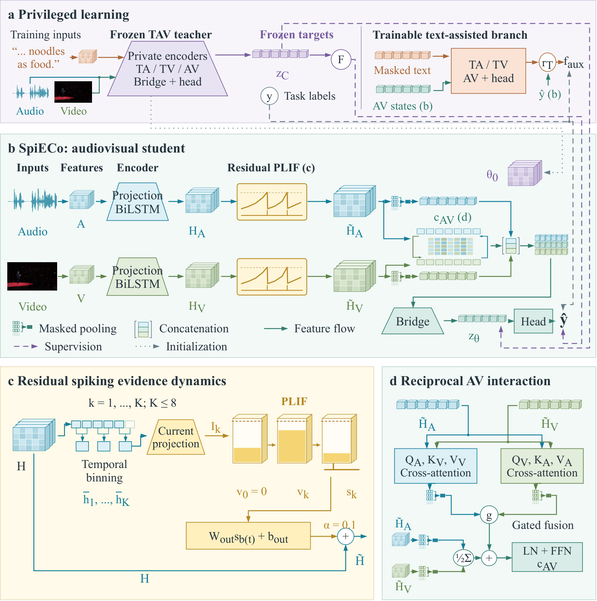

<div align="center">

<h1>SpiECo</h1>

<h3>Privileged Knowledge Consolidation through Spiking Evidence Dynamics<br>for Audiovisual Affective Understanding</h3>

<p><strong>Jiahao Qin and Yiwen Wang</strong></p>

<p>
  <a href="#citation"></a>
  <a href="LICENSE"></a>
  <a href="https://www.python.org/"></a>
  <a href="https://pytorch.org/"></a>
</p>

<p>
  <a href="#overview">Overview</a> &nbsp;|&nbsp;
  <a href="#training">Training</a> &nbsp;|&nbsp;
  <a href="#evaluation">Evaluation</a> &nbsp;|&nbsp;
  <a href="#citation">Citation</a>
</p>

</div>

---

**Official PyTorch implementation of SpiECo (Spiking Evidence Consolidation).** SpiECo consolidates knowledge from a text-audio-video teacher into a student that predicts from **audio and video alone**. Continuous modality-specific features and residual spiking dynamics are trained together; the deployed model needs neither a text encoder nor the teacher.

[Installation](#installation) · [Data](#data) · [Inference API](#av-only-inference) · [Reproducibility](#reproducibility) · [License](#license)

## Overview

<p align="center">
  <a href="assets/spieco_architecture.pdf">
    
  </a>
</p>

**Figure 1. SpiECo architecture and spiking evidence dynamics.**

**(a)** Complete-input teacher targets and a training-only text-assisted branch support privileged learning. **(b)** The audiovisual student combines private features with reciprocal interaction. **(c)** Residual PLIF adapters integrate feature currents and project emitted events back into the continuous pathway. **(d)** Bidirectional cross-attention constructs the audiovisual interaction features.

[Open the full-resolution figure](assets/spieco_architecture.png) · [Vector PDF](assets/spieco_architecture.pdf)

- **Consolidate privileged knowledge.** Prediction and latent targets transfer training-time multimodal information to the audiovisual student.
- **Combine continuous features with events.** Channel-wise parametric LIF adapters contribute residual corrections alongside continuous modality-specific representations.
- **Deploy with audio and video only.** Export removes the text-assisted branch; final refinement and evaluation use the audiovisual model alone.

### What is included

| Component | Entry point |
| --- | --- |
| Complete-input teacher | [`spieco/teacher.py`](spieco/teacher.py) |
| Consolidation model and AV-only student | [`spieco/student.py`](spieco/student.py) |
| Residual PLIF dynamics | [`spieco/spiking.py`](spieco/spiking.py) |
| Modality encoders and cross-attention | [`spieco/layers.py`](spieco/layers.py) |
| Training, target caching, refinement, and evaluation | [`spieco/cli.py`](spieco/cli.py) |
| Supervision objectives | [`spieco/objectives.py`](spieco/objectives.py) |
| Data contract and training protocol | [`docs/data.md`](docs/data.md) · [`docs/protocol.md`](docs/protocol.md) |
| Unit tests | [`tests/`](tests/) |

The release contains SpiECo code, documentation, and the architecture figure. Datasets, pretrained language-model weights, trained checkpoints, per-sample predictions, baseline implementations, and manuscript sources are not included.

## Installation

Use **Python 3.10 or later** and install a PyTorch build compatible with your GPU and driver first. Then run:

```bash
git clone https://github.com/D-ST-Sword/SpiECo.git
cd SpiECo
python -m pip install -e .
python -m unittest discover -s tests -v
python -m spieco.cli --help
```

Tests construct small synthetic inputs and a tiny text encoder. They do not download pretrained models or require benchmark data.

<details>
<summary><strong>Reference environment</strong></summary>

| Dependency | Packaging-check version |
| --- | --- |
| PyTorch | 2.0.1 |
| Transformers | 4.35.0 |
| NumPy | 1.26.4 |
| scikit-learn | 1.7.2 |
| SpikingJelly | 0.0.0.0.14 |

SpikingJelly is pinned in [`pyproject.toml`](pyproject.toml). The adapters use its PyTorch backend, not a custom CUDA kernel. The recorded CPU check verifies the package; choose a PyTorch/CUDA build appropriate for your own hardware.

</details>

## Data

Obtain the datasets and pretrained encoders under their providers' access conditions. The loader consumes a **trusted local prepared-feature pickle**, not raw audio or video. See [the input specification](docs/data.md) for fields, masks, splits, and preprocessing.

| Dataset | CLI name | Teacher text encoder | Text / audio / visual widths |
| --- | --- | --- | --- |
| UR-FUNNY | `urfunny` | `roberta-large` | 1024 / 81 / 371 |
| CMU-MOSI | `mosi` | `roberta-large` | 1024 / 5 / 20 |
| CH-SIMS | `sims` | `hfl/chinese-roberta-wwm-ext` | 768 / 33 / 709 |

Provide the pretrained model and its matching tokenizer in a local directory. Loading uses `local_files_only=True`. CH-SIMS uses its Chinese tokenizer and normalization fitted on valid training frames; the code does not use its unimodal sentiment labels.

## Training

Run the stages in order, using a new output directory for each stage. This example uses MOSI and seed 42. All three datasets use **five seeds: 7, 22, 42, 93, and 99**.

### 1. Train the complete-input teacher

```bash
spieco teacher \
  --dataset mosi --seed 42 \
  --data data/mosi.pkl \
  --encoder pretrained/roberta-large \
  --output runs/mosi_s42/teacher
```

### 2. Cache training-set teacher targets

```bash
spieco cache \
  --dataset mosi --seed 42 \
  --data data/mosi.pkl \
  --encoder pretrained/roberta-large \
  --teacher runs/mosi_s42/teacher/selected.pt \
  --output runs/mosi_s42/cache
```

### 3. Consolidate knowledge into the student

```bash
spieco student \
  --dataset mosi --seed 42 \
  --data data/mosi.pkl \
  --encoder pretrained/roberta-large \
  --teacher runs/mosi_s42/teacher/selected.pt \
  --cache runs/mosi_s42/cache \
  --output runs/mosi_s42/student
```

### 4. Refine the AV-only model

```bash
spieco refine \
  --dataset mosi --seed 42 \
  --data data/mosi.pkl \
  --checkpoint runs/mosi_s42/student/av_only.pt \
  --output runs/mosi_s42/refine
```

The final stage uses task labels without teacher targets or text input. Use `--device cuda:0` to select a GPU; `--device cpu` is available for small checks. The default device is CUDA.

<details>
<summary><strong>Training protocol and checkpoint selection</strong></summary>

| Stage | Input and supervision | Selected output |
| --- | --- | --- |
| Teacher | Text, audio, video, and task labels | `teacher/selected.pt` |
| Target cache | Training samples and the selected teacher | Prediction and latent targets |
| Consolidation | AV student, training-only text-assisted branch, labels, and teacher targets | `student/av_only.pt` |
| AV refinement | Audio, video, and task labels only | `refine/selected.pt` |

Teacher caches are restricted to training IDs and bound to the teacher and data hashes. Validation selects checkpoints; test data are evaluated separately. The exported AV model is checked against the fully text-erased student endpoint. Optimizers, losses, schedules, and selection rules are documented in [the training protocol](docs/protocol.md).

</details>

## Evaluation

```bash
spieco evaluate \
  --dataset mosi --seed 42 \
  --data data/mosi.pkl \
  --checkpoint runs/mosi_s42/refine/selected.pt \
  --split test \
  --output runs/mosi_s42/test
```

Evaluation does not construct text tokens or load a text encoder. The model receives only audio/video feature tensors and their masks.

<details>
<summary><strong>Metric conventions</strong></summary>

- **UR-FUNNY:** MAE, correlation, binary accuracy, and weighted F1 on signed targets; positive predictions have scores greater than zero.
- **MOSI:** MAE, correlation, and Acc-7 on the full test split; binary accuracy and weighted F1 on non-neutral samples.
- **CH-SIMS:** MAE, correlation, Acc-2, weighted F1, Acc-3, and Acc-5 using scores clipped to `[-1, 1]`.

Accuracy and F1 are stored as fractions, not percentages. The [protocol](docs/protocol.md) gives exact boundaries and evaluation conventions.

</details>

## AV-only inference

```python
import torch
from spieco import AVOnly

model = AVOnly("mosi").eval()
checkpoint = torch.load(
    "runs/mosi_s42/refine/selected.pt",
    map_location="cpu",
    weights_only=False,
)
model.load_state_dict(checkpoint["model"], strict=True)

with torch.no_grad():
    output = model({
        "audio": audio_features,     # [B, La, 5]
        "vision": visual_features,   # [B, Lv, 20]
        "audio_mask": audio_mask,    # bool [B, La]
        "vision_mask": visual_mask,  # bool [B, Lv]
    })
    prediction = output["M"]        # [B]
```

Use the same feature preprocessing as training, including the saved CH-SIMS normalization statistics. Load only trusted checkpoint and pickle files.

## Reproducibility

The release packages SpiECo's model computations and a portable training interface. Tests cover padded-input handling, spiking-state reset, consolidation losses and gradients, text-free export, Chinese token masking, metric conventions, and a synthetic end-to-end workflow. See [verification notes](docs/verification.md) for the completed packaging checks and comparisons with the archived implementation.

Benchmark reproduction additionally requires the matching prepared features, tokenizer, and pretrained encoder. The repository contains neither those assets nor trained checkpoints.

## Citation

If you use SpiECo in your research, please cite our paper:

```bibtex
@misc{qin2026spieco,
  title         = {{SpiECo}: Privileged Knowledge Consolidation through Spiking Evidence Dynamics for Audiovisual Affective Understanding},
  author        = {Jiahao Qin and Yiwen Wang},
  year          = {2026},
  archivePrefix = {arXiv}
}
```

The arXiv identifier will be added once confirmed. Machine-readable metadata is provided in [CITATION.cff](CITATION.cff).

## License

SpiECo code is released under the **[MIT License](LICENSE)**.

Copyright (c) 2026 Jiahao Qin and Yiwen Wang.

Third-party libraries, datasets, pretrained models, and example media remain subject to their respective licenses and access terms.
